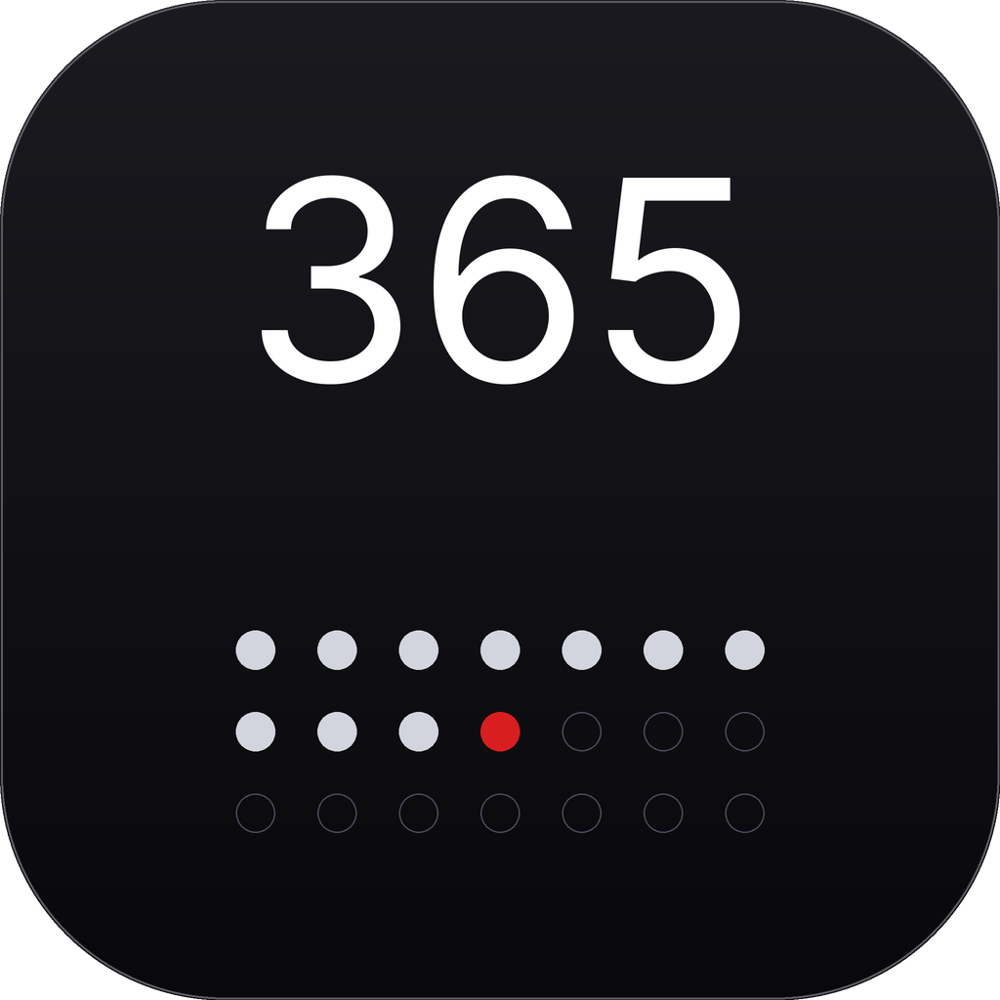
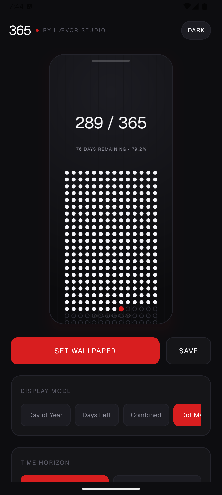
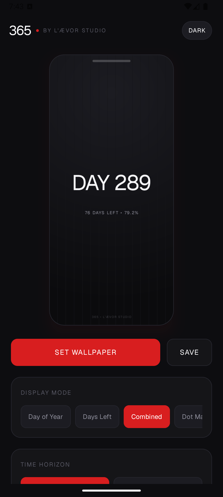

# 365 — Official Releases & Downloads

  
  
<strong>by L’ÆVOR STUDIO</strong>

  
<em>An ultra-minimal, typography-driven daily wallpaper utility that transforms your desktop and mobile background into an intentional visualization of time.</em>

  

    
    
    
    
  

---

## ⚡ Direct Downloads

All official release binaries, installers, and APKs are hosted directly in this repository's [Releases](../../releases).

| Platform | Distribution Type | File | Architecture | Download |
| :--- | :--- | :--- | :--- | :--- |
| **Windows 10 / 11** | **Setup Wizard (Recommended)** | `365-Setup-1.4.0.exe` | 64-bit | [**Download (.exe)**](../../releases/download/v1.4.0/365-Setup-1.4.0.exe) |
| **Windows 10 / 11** | **Standalone Portable** | `Day.exe` | 64-bit | [**Download (.exe)**](../../releases/download/v1.4.0/Day.exe) |
| **Android** | **Universal APK** | `365-Android-v1.0.apk` | ARM64 / universal | [**Download (.apk)**](../../releases/download/v1.4.0/365-Android-v1.0.apk) |

> [!NOTE]  
> 365 is completely free. No subscription, no telemetry, no account required.

---

## 📸 Visual Showcase

  
  

---

## ✨ Features & Highlights

- **Zero Background Resource Usage**:  
  Runs 100% offline. Consumes **0% CPU and 0 MB RAM** while you work. The background scheduler triggers silently for milliseconds at `00:01 AM` (and upon PC unlock), updates the wallpaper canvas, and immediately exits.
- **Dynamic Dots Matrix**:  
  A complete geometric representation of all 365 days of the year. Past days are solid white markers, upcoming days remain subtle hollow outlines, and today's date pulses with a distinctive crimson highlight (`#D81E1F`).
- **4 Typography Modes**:
  1. **Mode A (Day of Year)**: Clean day counter (e.g. `260 • OF 365`).
  2. **Mode B (Days Remaining)**: Time remaining countdown (e.g. `105 DAYS LEFT`).
  3. **Mode C (Combined)**: Both current day and days remaining with year progress percentage.
  4. **Mode D (Dots Matrix)**: Full calendar grid with active coordinate pinpointing.
- **Dual Visual Themes**:  
  Seamlessly switch between **Dark Spotlight** (Carbon Obsidian Ambient) and **Linen Weave** (Architectural Ivory Light).
- **Subtle Year Progress (%)**:  
  Minimalist live completion tracker keeping you mindful of time passing throughout the year.

---

## 🚀 Installation & Getting Started

### Windows
1. Download **`365-Setup-1.4.0.exe`** from the table above or the [Releases tab](../../releases).
2. Run the installer (requires no administrative privileges).
3. Select your preferred display mode and theme in the settings window.
4. Click **"Apply Wallpaper"**.
5. Done! Your desktop wallpaper will now automatically update every midnight and whenever you power on your computer.

### Android
1. Download **`365-Android-v1.0.apk`**.
2. Tap the downloaded file and allow installation from unknown sources if prompted.
3. Open the app to configure your daily wallpaper schedule.

---

## 🌐 Official Channels & Studio

- **Official Webpage**: [365leavorstudio.vercel.app](https://365leavorstudio.vercel.app/)
- **Studio Portfolio**: [L’ÆVOR STUDIO](https://www.instagram.com/leavorstudio/)
- **Bug Reports & Feedback**: Please open an issue in the [Issues](../../issues) tab of this repository.

---

&copy; 2026 L’ÆVOR STUDIO. All rights reserved.
